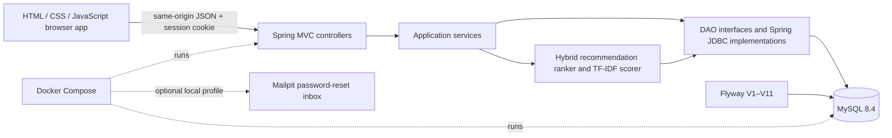

# RecomAI — AI-Powered Personalized Recommendation System


RecomAI is the existing GUVI Galgotias project: a personalized discovery hub for learning and career resources. It uses a user’s stated interests and onboarding choices together with their ratings and interaction history to rank resources and explain the signals behind the ranking.

## Problem statement and objectives

People looking for useful learning and career material often face broad catalogs with little help deciding what to read or try next. RecomAI addresses that discovery problem with an account-based catalog and a transparent, heuristic recommendation ranker. Its objectives are to collect explicit preferences, learn cautiously from activity, provide a useful first-visit experience, explain ranking signals, and let users manage saved resources and feedback.

The catalog taxonomy is **Technology**, **Business & Finance**, **Learning & Career**, **Health & Fitness**, and **Creative & Lifestyle**. Recommendations are heuristic rankings, not calibrated probabilities or a claim of measured effectiveness.

## Current implementation

- Java 21, Spring Boot 4.1, Spring MVC with embedded Tomcat, and Spring JDBC.
- MySQL 8.4 for local Docker development; Spring Boot's Flyway integration validates and applies the existing versioned migrations at application startup.
- Session-based registration (new users are signed in automatically), login, profile updates, lightweight onboarding (goal, one niche, and up to three optional topics), and correct session restoration after refresh. Auth fallback forms use POST, both auth actions are locked while a request runs, and startup distinguishes a 401 from service failures.
- Secure forgot-password and reset flow: single-use 256-bit random tokens, SHA-256 hashes in MySQL, 15-minute expiry, previous-token invalidation, per-account and per-source throttling, and auth-version session revocation after a successful reset.
- A Saved resources page that rebuilds the reading list from the user's saved interaction history.
- Personal progress tracking (in progress/completed), weekly activity summary, and owner-scoped named collections for saved resources.
- A balanced catalog of 200 public learning and career resources on a clean startup: the original 25 Flyway-seeded items plus 175 curated resources across the five niches, with source, type, difficulty, estimated time, descriptions, and three topic tags. An idempotent startup loader skips URLs already present, preserving existing catalog records.
- Admin catalog tools for CSV preview/validation/transactional import and bulk activate/deactivate. CSV imports require public HTTP(S) URLs, an active niche, supported type and level, 2+ sentence descriptions, and 3–6 existing topic tags.
- Token-aware catalog search/filtering across titles, descriptions, categories, publishers, and topic tags; phrase searches such as “cloud computing courses” match existing resource topics and become weak preference signals.
- User-scoped catalog search events; matched searches add a low-strength signal to relevant resource topics.
- Dynamic positive/negative topic profiles with configurable signal weights, 45-day behavior decay, confidence labels, and recent direction indicators.
- A confidence-qualified "New interest detected" cue when repeated activity points to a growing topic.
- A hybrid, explainable recommendation ranker using selected categories/topics, curated topic relations, TF-IDF cosine similarity over item title/description/category/topics, personal ratings and behavior, cross-user popularity, and gated implicit collaborative evidence. The feed's familiar/related/exploration mix defaults to 70/20/10 and is configurable.
- Admin analytics and catalog management for accounts with the `ADMIN` role.
- Admin system settings for familiar/related/discovery shares, validation that shares total 100%, live top-10 preview without saving, and a persisted audit trail.
- Plain HTML, CSS, and JavaScript served same-origin. The frontend entry uses ES modules for API and theme utilities, hash-based panel navigation, remembered dark/light dashboard themes, accessible ratings, retry/error states, paginated catalog, clear-history, personalization reset, JSON export, and account deletion.
- The Maven suite currently has 127 test cases across recommendation scoring, collections, admin settings, JDBC, authentication, reset-token rules, session revocation, catalog import, and security filters. `npm run test:e2e` uses an isolated MySQL 8.4 database and Mailpit; its current browser flows cover signup, onboarding/cold start, sign-in, password recovery, recommendations, feedback, catalog search/filters, progress, collections, privacy export, theme persistence and cross-account isolation.
- Admin analytics currently reports recorded account/catalog/activity/rating/recommendation aggregates. It does not yet report impression-based CTR, save-rate, or a signup-to-return funnel because the application does not record those events. User administration and demo-data generation/purge are also not implemented. Do not present those metrics or controls as available.

## Architecture



Controllers handle HTTP requests, services validate and coordinate application behavior, DAO classes execute parameterized SQL using Spring JDBC, and the recommendation engine ranks a bounded candidate set with content and aggregate behavior features. Flyway migrations are append-only and are kept in `src/main/resources/db/migration`.

## Prerequisites

For the one-command Docker setup on Windows:

- Docker Desktop with its Linux container engine running.
- PowerShell.

The Compose setup builds the backend with Java 21 and Maven inside Docker. You do not need to install Java, Maven, or MySQL separately to run the complete application.

For local development outside Docker, install Java 21 and use the included Maven Wrapper (`mvnw.cmd`).

## Start the complete application

From this project directory, run:

```powershell
.\start-local.ps1
```

On its first run, the script creates an ignored local `.env` file with randomly generated database passwords, then builds and starts the backend and MySQL containers. It does not print the passwords. Open [http://localhost:8080](http://localhost:8080) when the script reports that the services are ready. The health endpoint at [http://localhost:8080/api/health](http://localhost:8080/api/health) reports both application and database status.

The database is exposed only on `127.0.0.1:3307` so it does not conflict with a local MySQL server using port 3306. The app uses port 8080. If either port is occupied, change `MYSQL_HOST_PORT` or `APP_HOST_PORT` in `.env` before starting again.

### Environment variables

`.env` is local-only and ignored by Git. `.env.example` documents the variables without containing real credentials.

| Variable | Purpose | Default |
| --- | --- | --- |
| `MYSQL_DATABASE` | Database created by the MySQL image | `ai_recommendation_system` |
| `DB_USERNAME` | Non-root application database user | `recommendation_app` |
| `DB_PASSWORD` | Application user's password | Randomly generated by `start-local.ps1` |
| `MYSQL_ROOT_PASSWORD` | Local MySQL administrative password | Randomly generated by `start-local.ps1` |
| `MYSQL_HOST_PORT` | Loopback host port mapped to MySQL 3306 | `3307` |
| `APP_HOST_PORT` | Loopback host port mapped to the web app 8080 | `8080` |
| `SESSION_COOKIE_SECURE` | Mark session cookie secure (enable for HTTPS deployments) | `false` locally |
| `FLYWAY_BASELINE_ON_MIGRATE` | Allow a baseline only for a verified legacy schema | `false` |
| `APP_PUBLIC_URL` | Trusted public origin used when building reset links | `http://localhost:8080` |
| `SMTP_HOST`, `SMTP_PORT`, `SMTP_USERNAME`, `SMTP_PASSWORD` | Mail transport settings | Local Mailpit defaults; credentials empty |
| `SMTP_AUTH`, `SMTP_STARTTLS`, `SMTP_FROM` | Mail transport behavior and sender | `false`, `false`, `no-reply@recomai.local` |
| `MAILPIT_HOST_PORT`, `COMPOSE_PROFILES` | Optional local email-capture profile | `8025`, `local-mail` |
| `PASSWORD_RESET_COOLDOWN_SECONDS` | Per-account reset-request cooldown | `60` |
| `RECOMMENDATION_FAMILIAR_SHARE`, `RECOMMENDATION_RELATED_SHARE`, `RECOMMENDATION_DISCOVERY_SHARE` | Recommendation feed mix; shares must total 1.0 | `0.70`, `0.20`, `0.10` |
| `SIGNAL_VIEW`, `SIGNAL_CLICK`, `SIGNAL_READ_PROGRESS`, `SIGNAL_SAVE`, `SIGNAL_PURCHASE`, `SIGNAL_LIKE`, `SIGNAL_DISLIKE`, `SIGNAL_HIDE`, `SIGNAL_SHARE`, `SIGNAL_SKIP`, `SIGNAL_MORE_LIKE`, `SIGNAL_SEARCH` | Relative interaction-signal weights | See `.env.example` |
| `PORT`, `SERVER_PORT` | Embedded server port for non-Compose runs | `8080` |

To configure manually, copy `.env.example` to `.env` and replace both password examples with unique secrets before running `docker compose up --build --wait`. Never commit `.env` or put production credentials in Java source code.

The `.env.example` lists the Compose settings and safe placeholders. `PORT` and `SERVER_PORT` are optional backend-only overrides for non-Compose runs. Docker passes optional feed-share and interaction-signal weights to the backend; the default search signal is deliberately small (`SIGNAL_SEARCH=0.12`). Do not copy credentials from a local `.env` into documentation, source files, or GitHub.

### Stop and restart

Stop the containers while preserving database contents:

```powershell
docker compose down
```

Start them again:

```powershell
.\start-local.ps1
```

The named `mysql_data` volume persists MySQL files across container restarts and `docker compose down`. To deliberately erase the local database and its saved data, use `docker compose down --volumes`; the next startup will create an empty database and rerun migrations. Keep the volume unless you intend to delete that data.

Useful status and logs:

```powershell
docker compose ps
docker compose logs -f backend
docker compose logs -f mysql
```

## Database and Flyway

The Compose MySQL 8.4 service creates the database and an application-specific, non-root account from `.env`. Compose waits for MySQL's health check before starting Spring Boot. A named volume persists database data. No manual database or table creation is needed for a new Docker volume. After Flyway completes, the idempotent `CatalogSeedLoader` imports 175 additional curated URLs and topic mappings; repeated starts skip URLs already present. It does not reset the database or remove user/catalog data. The backend image build runs `mvn clean verify` before packaging, so it fails if the automated tests fail.

At application startup, the `spring-boot-starter-flyway` integration reads the SQL migrations in `src/main/resources/db/migration`. A fresh database applies V1 through V11 in order. Flyway records applied versions in `flyway_schema_history`; migrations are append-only and should not be edited after use. `schema.sql` is a reference of the current schema, not the runtime initializer. Existing project databases with valid migration history continue from their recorded version. Baseline-on-migrate is off by default; an operator should only enable it for a legacy database after verifying the schema matches V1. Read [docs/database-migrations.md](docs/database-migrations.md) before using an existing database.

The schema covers users, five niche categories and their topics, tagged resources, onboarding answers, decaying user-topic signals, interactions and bounded search queries, feedback, recommendation batches/results, and password-reset tokens. V3 stores curated topic relationships and structured recommendation reasoning; V4 allows authenticated search events without requiring a content item; V5 adds reset-token storage and auth-version revocation; V6 stores the ranker's actual feature contributions as optional JSON; V7 adds an explicit editorial-pick signal and allows its recommendation reason; V8 repairs 13 catalog URLs confirmed to return HTTP 404 without changing the schema. Foreign keys, uniqueness/check constraints, and indexes are defined by the migration scripts. The starter data stores metadata and outbound links, not copied articles. The 25 editorial picks are explicit curation signals, not synthetic behavior; admins can change each flag.

## API overview

The frontend calls the backend with same-origin `/api` URLs and an HttpOnly, SameSite session cookie.

Registration returns `201 Created` with the new profile and starts the same server-side session used by login. The frontend opens the workspace from that response; a page refresh checks the persisted session with `GET /api/users/me`. New users are then sent to the short onboarding flow; after saving it, the app generates and opens the first recommendations. If registration succeeds but does not return a profile, the UI offers the login form instead of displaying a success state.

| Area | Endpoint examples |
| --- | --- |
| Health/database connection | `GET /api/health` |
| Account | `POST /api/auth/register`, `POST /api/auth/login`, `POST /api/auth/logout`, `POST /api/auth/password-reset/request`, `POST /api/auth/password-reset/complete`, `GET /api/users/me` |
| Profile and signals | `PATCH /api/users/me/profile`, `GET /api/users/me/recommendation-profile`, `GET/PUT /api/users/me/preferences`, `PUT /api/users/me/interests/{interestId}` |
| Discovery onboarding/profile | `GET /api/discovery/niches`, `GET/POST /api/users/me/onboarding`, `GET /api/users/me/interests/insights` |
| Catalog browsing | `GET /api/categories`, `GET /api/interests`, `GET /api/items`, `GET /api/items/search`, `GET /api/items/{itemId}` |
| Interactions, feedback, and privacy | `POST/GET/DELETE /api/users/me/interactions`, `GET /api/users/me/interactions/progress`, `POST /api/users/me/interactions/search`, `GET/POST /api/users/me/feedback`, `PUT /api/users/me/feedback/{itemId}`, `GET /api/users/me/export`, `DELETE /api/users/me`, `DELETE /api/users/me/personalization` |
| Recommendations | `POST/GET /api/users/me/recommendations`, `GET /api/users/me/recommendations/discovery`, `GET /api/recommendation-info` |
| Admin | `/api/admin/categories`, `/api/admin/interests`, `/api/admin/items`, `POST /api/admin/items/import/preview`, `POST /api/admin/items/import/commit`, `PATCH /api/admin/items/active`, `GET /api/admin/analytics/summary`, `GET /api/admin/analytics/insights`, `GET/PUT /api/admin/settings`, `POST /api/admin/settings/preview`, `GET /api/admin/settings/audit` |
| Collections and user data | `/api/users/me/collections`, `/api/users/me/export`, `DELETE /api/users/me/personalization` |

Admin endpoints require an account whose database role is `ADMIN`. For a local demo, register an account, then promote it using a trusted MySQL client and the account's email. Sign out and back in to refresh the session role. Do not expose database administration credentials to the browser.

Health checks, registration/login/reset requests, and catalog/taxonomy read endpoints are available before sign-in. User-specific routes under `/api/users/me/**` require a valid session; admin routes under `/api/admin/**` require a session with the `ADMIN` role. See each controller for request fields and status codes.

The current scorer uses normalized inputs and this weighted ranking formula (components are 0–1): `12×category + 24×direct-topic + 10×related-topic + 8×metadata-cosine + 7×rating-affinity + 16×tanh(positive-signal/2) + 10×catalog-popularity + 10×collaborative-evidence + 3×onboarding-goal − min(positive subtotal, 20×tanh(negative-signal/2))`. The result is clamped to 0–100 and stored as a **ranking score, not a probability**. The API persists the component point contributions; the UI exposes them under “See the signals used.” The weights are a documented heuristic, not trained from a claim of measured superiority.

Metadata cosine uses normalized TF-IDF vectors from real item title, description, category, and mapped topics, with the user's recent positive item interactions as seed documents. It does not return the same seed item as a content-similarity match. Cross-user implicit similarity uses positive item interactions from the last 180 days, cosine/Jaccard-style user overlap (`shared positive items / sqrt(item counts)`), and excludes items rejected by those users. A neighbor needs at least two overlapping positive items, and an item needs at least three distinct neighbor users before collaborative evidence contributes. Catalog popularity uses positive events from the last 90 days, excludes the current user, and is labelled popular only with at least three other users. With less evidence these components are zero; cold-start cards are labelled exploratory rather than claiming the system knows a preference. Recent item views/clicks/progress are suppressed from the feed for 14 days, and explicit dislike/hide remains excluded.

The 70/20/10 familiar/related/exploration bucket mix and individual interaction weights are configurable. Search is weak by default (`0.12`); explicit actions such as saving, liking, and not being interested carry stronger weights. Passive activity (`VIEW`, `CLICK`, `READ_PROGRESS`), `MORE_LIKE`, and negative feedback adapt topic preferences; explicit positive item actions (`LIKE`, `SAVE`, `PURCHASE`, `SHARE`) score the item directly and do not also update its topic profile. This keeps one action from being counted in both per-item and topic-match components. Behavior uses a 45-day half-life and onboarding-only signals a 60-day half-life. Onboarding topic, category, and goal signals taper as topic-level behavioral events accumulate (`1 - exp(-eventCount / 10)`). Candidate generation is capped at 1,000 preliminarily ranked active resources; the final feed remains at most 50. If a bucket has too few candidates, remaining slots come from the highest-scoring eligible resources, with category variety when alternatives exist. A strong `DISLIKE` or `HIDE` excludes that specific resource; negative topic evidence penalizes related resources.

There is no claim yet that this heuristic beats a baseline. The validation snapshot recorded 25 catalog items, 6 interactions, and 1 rating before the new idempotent catalog seed was added; the catalog loader increases catalog coverage and marks 25 editorial selections without adding synthetic user behavior. Real feedback is still too limited for a trustworthy time-aware Precision@K, Recall@K, or NDCG comparison. The app does not record verified recommendation impressions, so click-through rate and engagement lift are not available. Deterministic scorer tests validate algorithm behavior on synthetic cases; they are not real-world performance measurements. Admin analytics reports observed activity counts; it does not label them as recommendation effectiveness. See [the post-implementation validation record](docs/recomai-quality-validation.md).

## Build and test

Run the automated suite and package verification:

```powershell
.\mvnw.cmd test
.\mvnw.cmd verify
```

Maven unit and MVC tests do not replace a live MySQL check. The project targets Java 21; use a Java 21 runtime for the official verification. Start the app with `start-local.ps1`, verify Compose services are healthy, and check `http://localhost:8080/api/health` (which runs `SELECT 1` through Spring JDBC). Install the browser-test dependency with `npm ci`; Windows uses the installed Edge browser by default, and other platforms can install Chromium with `npx playwright install chromium`. Then run `npm run test:e2e`. The runner creates a uniquely named Compose project with a fresh MySQL 8.4 volume and stops only that temporary project's containers when tests finish. It retains the isolated volume and never uses or deletes the main development database. Pass Playwright flags after `--`, for example `npm run test:e2e -- --grep "cold-start"`.

To request each catalog link and print its HTTP result (requires outbound network access), run `npm run check:catalog-links`. The script uses HEAD with a GET fallback and a timeout. A successful response is only a reachability check at that moment, not a guarantee that the linked content is suitable or permanent.

Flyway applies V1–V11 at startup. V9 adds explicit completion events and owner-scoped saved collections. V10 adds persisted recommendation feed shares and an admin audit table. V11 adds optional per-user interaction request IDs and a progress-state lookup index; replays of the same request do not reapply inferred preference signals, while new request IDs remain distinct activity. All migrations are append-only and preserve existing user/catalog records. The catalog loader then adds 175 curated items once by URL, with 25 explicitly selected editor picks on first insert. Later startups skip existing URLs and preserve admin changes to those flags. Playwright uses a fresh isolated database and does not touch the development database; its generated test volume is retained by the runner.

## Security, privacy, and retention

- The app serves its own frontend and API from one origin; no cross-origin API access is enabled. Session cookies are `HttpOnly` and `SameSite=Strict`. Set `SESSION_COOKIE_SECURE=true` behind HTTPS. The local Docker ports bind to loopback, and MySQL is not published beyond the local machine.
- Password recovery returns the same `202 Accepted` text for known and unknown email addresses. Reset tokens are sent only by email, never returned by an API. The trusted reset URL comes from `APP_PUBLIC_URL`, not the request Host header, and places the token in the URL fragment; the browser removes it before sending it in a POST body. The response policy is `no-referrer`.
- Local development starts Mailpit through `start-local.ps1`; its inbox is at `http://localhost:8025` and binds to loopback. Mail capture uses the Compose `local-mail` profile and is not enabled in production. Configure `APP_PUBLIC_URL`, `SMTP_HOST`, `SMTP_PORT`, `SMTP_USERNAME`, `SMTP_PASSWORD`, `SMTP_AUTH`, `SMTP_STARTTLS`, and `SMTP_FROM` for production. The production profile requires an HTTPS `APP_PUBLIC_URL` and secure session cookies.
- To try a reset locally, run `.\start-local.ps1`, open `http://localhost:8080`, choose **Log in → Forgot password?**, and submit your account email. Open Mailpit at `http://localhost:8025`, follow the reset link within 15 minutes, and set a new password. Resetting does not sign you in; use the new password on the sign-in screen. Stop with `docker compose down` (do not add `--volumes` if you want to keep your database).
- Responses include a restrictive Content Security Policy, clickjacking/MIME protections, and a request ID response header. Failed login attempts are limited to 10 per client IP per minute in each application process. This in-memory limiter is suitable as a local hardening layer; a public multi-instance deployment also needs a shared edge limiter and trusted-proxy configuration.
- The app does not automatically purge activity. Users can clear their interaction/search history and inferred topic signals; this also removes stored recommendation batches while retaining ratings and explicit preferences. Account deletion requires the authenticated session and typing `DELETE`; the existing user foreign keys cascade to dependent personal data, then the server invalidates the session.
- For public deployment, terminate TLS at a trusted proxy, set secure cookies, add CSRF origin/token protections appropriate to the deployment, externalize secrets, and use a shared rate limiter. This Compose setup is for local development only.

Build the backend image and start both services directly:

```powershell
docker compose build backend
docker compose up --wait
```

## Project layout

```text
src/main/java/com/guvi/recommendationsystem/
  controller/       HTTP endpoints
  dao/              DAO interfaces and Spring JDBC implementations
  exception/        Application exceptions
  model/            Request, response, and domain types
  recommendation/   Scoring engine and TF-IDF metadata feature scorer
  service/          Validation and application workflows
  web/              Session, request context, rate limiting, and security headers
src/main/resources/
  db/migration/     Flyway V1 through V11 migrations
  static/           Browser application
  catalog/          Idempotent TSV source for curated public resources
e2e/                 Playwright browser journey tests
  application.properties
docker-compose.yml  MySQL, backend, and opt-in local Mailpit service
Dockerfile          Java 21 multi-stage backend image
start-local.ps1     One-command local startup and safe secret generation
```

See [docs/phase-0-requirements-and-design.md](docs/phase-0-requirements-and-design.md), [docs/architecture-audit.md](docs/architecture-audit.md), and [submission/SUBMISSION-CHECKLIST.md](submission/SUBMISSION-CHECKLIST.md) for project and submission context.

## Screenshots

No genuine application screenshots are committed yet. See [docs/screenshots/README.md](docs/screenshots/README.md) for safe capture and naming guidance. Add screenshots only after capturing them from the running application; do not use mockups as evidence of implemented behavior.

## Code organization notes

The Maven source tree separates controllers, services, JDBC DAOs, domain/request models, recommendation scoring, and web/session concerns. This is suitable for the current academic project. Future refactoring should stay incremental: keep SQL in DAO classes, keep scoring in the recommendation package, and add focused tests alongside changes rather than moving packages or renaming public APIs during submission preparation.

## Contributors and license

The repository currently has one initial project commit; the extensive current working-tree changes are not committed and therefore are not yet represented in GitHub contribution history. No license file or license grant is present. Choose and add a license only if the project owner intends to grant those rights; until then, do not describe the repository as open source.
