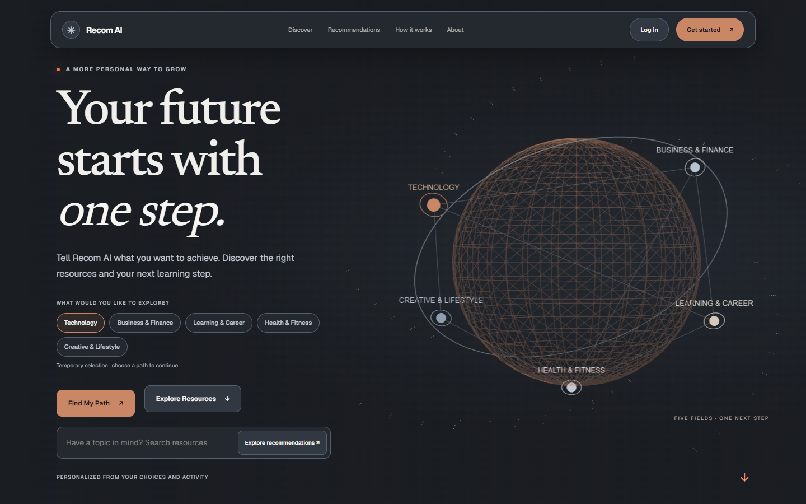
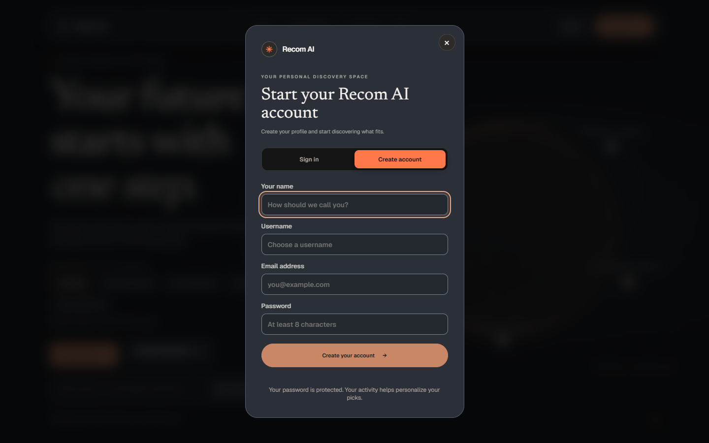
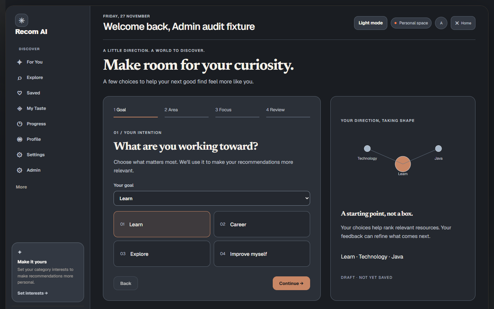
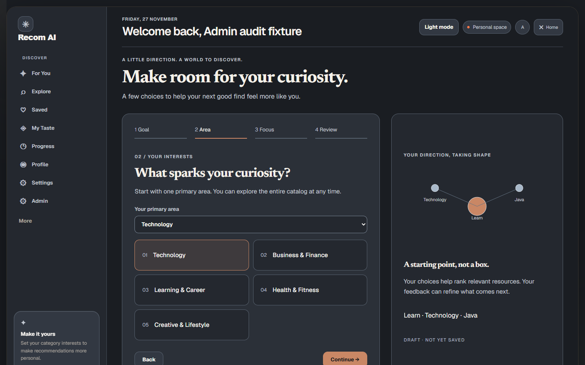
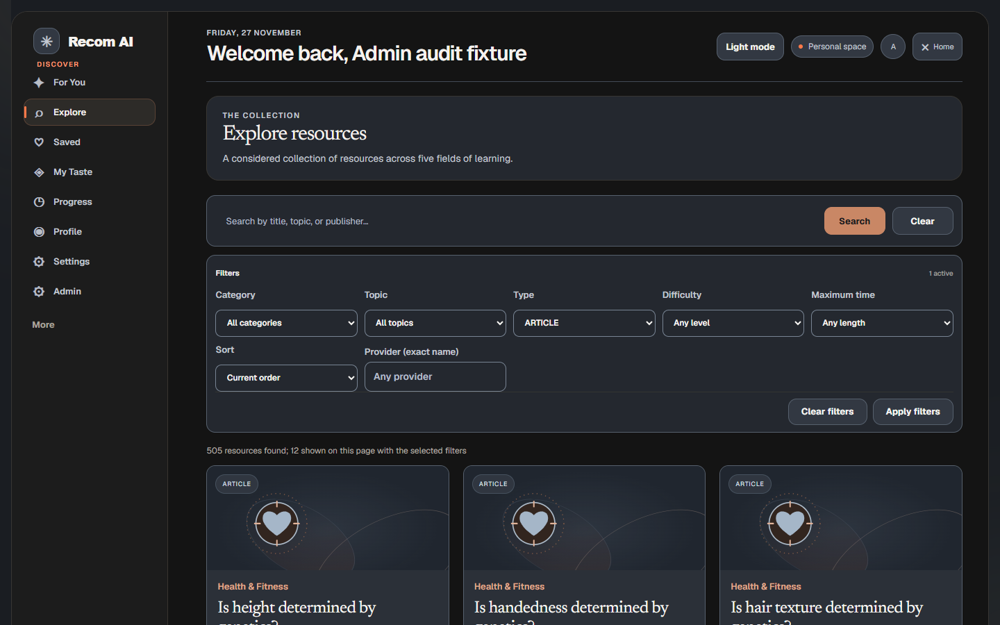
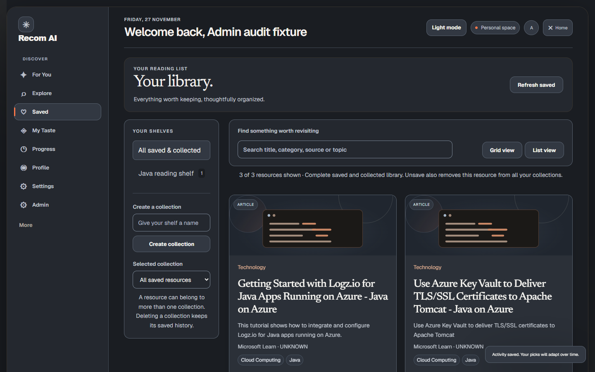
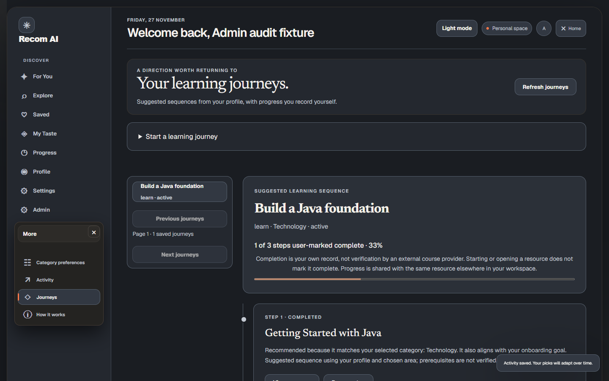
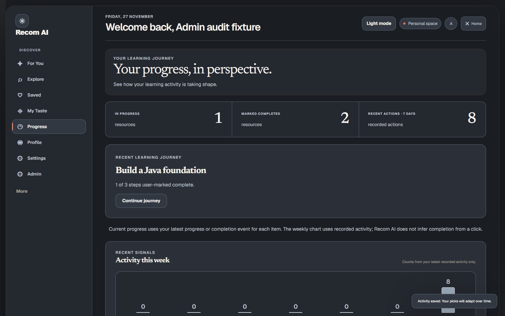
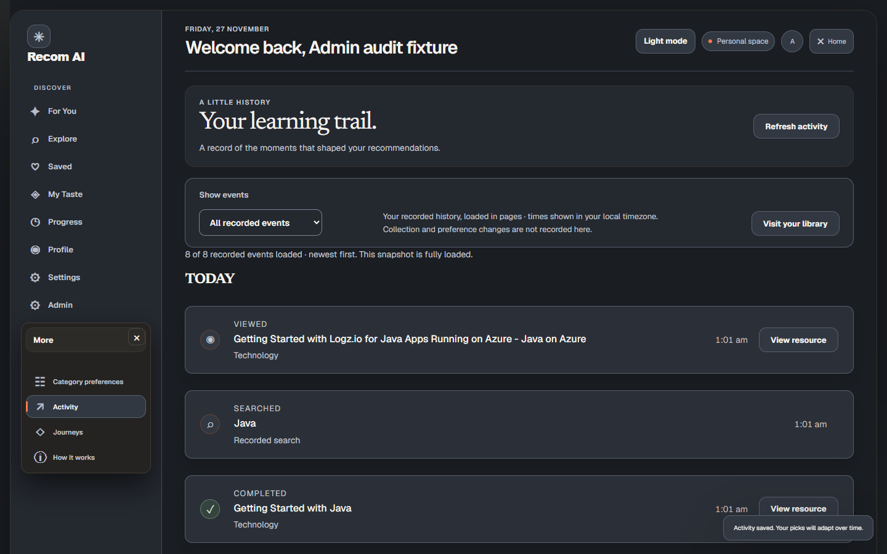
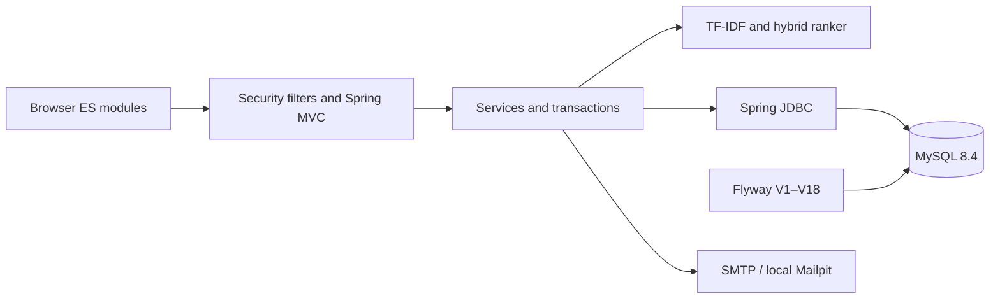

# Recom AI

AI-powered personalized learning resource recommendation system.

  

## Overview

Recom AI helps learners find educational resources that match their goals, topics and recorded feedback. It combines explainable recommendations with saved resources, collections, learning journeys and explicit progress.

## Problem statement

Large educational catalogs make it difficult to identify a useful next step. Keyword search alone does not account for a learner's interests, purpose or previous feedback.

## Proposed solution

Learners choose goals and topics. TF-IDF cosine similarity and a weighted hybrid model rank existing resource metadata, explain each pick and incorporate later feedback. No LLM or neural network is used.

## Application preview



[Complete visual walkthrough](docs/screenshots/README.md) · [Source navigation](#source-code-navigation) · [Verified quality report](docs/code-quality/README.md)

## How Recom AI works

### 1. Create an account

Register and sign in with a session cookie.



### 2. Select a learning goal

Choose a purpose such as Learn or Career.



### 3. Choose interests and topics

Select a primary area and optional focus topics; refine them later in My Taste.



### 4. Receive personalized recommendations

For You combines preferences, resource metadata and available feedback.


### 5. Understand recommendation explanations

Inspect the reasons and component ranking points. Scores are not probabilities.


### 6. Explore courses and readings

Intersect text, category, type, topic, provider, difficulty and duration filters.



### 7. Save useful resources

Keep resources in your library and organize overlapping collections.



### 8. Generate learning journeys

Persist a suggested order of existing resources for a goal and topic.



### 9. Track learning progress

Explicitly mark progress or completion; clicking does not imply completion.



### 10. Improve recommendations through feedback

Saves, likes, dislikes, hides and other supported events influence future rankings.



## Key features

- Explainable familiar, related and discovery recommendation buckets.
- Public paginated catalog with independent filters and source attribution.
- Owner-scoped saved resources, collections, journeys, progress and activity.
- Profile/settings, account deletion and SMTP password reset.
- Administrator catalog editing, revision checks, import preview, edition review and transactional commit.
- Responsive Premium Graphite UI, keyboard controls and reduced-motion support.

## Technology stack

| Area | Actual implementation |
|---|---|
| Frontend | HTML, CSS, JavaScript ES modules; Three.js 0.180.0 |
| Backend | Java 21; Spring Boot 4.1.1; Spring MVC; Spring JDBC |
| Database | MySQL 8.4; Flyway V1–V18 |
| Algorithms | TF-IDF, cosine similarity, weighted hybrid scoring |
| Testing | JUnit, Spring MVC tests, Mockito, Playwright 1.64.0, JaCoCo 0.8.14 |
| Build | Maven wrapper 3.9.16; npm lockfile |
| Infrastructure | Docker Compose, local Mailpit, optional production overlay |

## System architecture



Maven packages `frontend/` as Spring Boot static resources. Controllers call validated services and DAOs; MySQL persists metadata, preferences, recommendation batches and learning state. [Architecture and workflows](docs/architecture/README.md).

## Recommendation engine

TF = `1+ln(frequency)`; IDF = `1+ln((N+1)/(df+1))`. L2-normalized resource vectors are compared with a normalized profile of positive history and selected topics. Empty vectors produce no positive cosine match.

Positive points = `12 category + 24 topic + 10 related + 8 cosine + 7 rating + 16 tanh(positive/2) + 10 popularity + 10 collaboration + 3 purpose + 5 editor`. Subtract up to `20 tanh(negative/2)`, bounded by positive points. Popularity/collaboration require at least three supporting observations. Strong negative feedback excludes candidates. Default feed shares are 70/20/10 with stable item-ID ties and bounded near-tie category diversity.

Example: category=1, topic=1, cosine=.5 and all other signals zero yields `12+24+8×.5=40` ranking points, not 40% confidence. [Exact definitions, decay, TF-IDF numerical example and limitations](docs/algorithms/README.md).

## Database architecture

[ER diagram](docs/database/README.md) · [schema-only DDL](docs/technical/schema-only.sql) · [migrations](backend/src/main/resources/db/migration/).

The inspected schema has 29 application tables plus Flyway history. Foreign keys preserve identities; canonical hashes and source/external IDs prevent repeat imports. Owner predicates protect private learning data. Service transactions serialize dependent writes. Applied V1–V18 are immutable; fresh installations initialize through Flyway and the curated loader.

## Educational dataset

Verified local snapshot: **2,365 resources**, including **505 ARTICLE resources**. Fresh startup supplies **200 curated links**; two explicit licensed metadata imports add **2,165 accepted resources**. No private database is needed.

| Type | Resources |
|---|---:|
| ARTICLE | 505 |
| COURSE | 1513 |
| DOCUMENTATION | 14 |
| GUIDE | 277 |
| PROJECT | 2 |
| RESOURCE | 38 |
| TOOL | 14 |
| VIDEO | 2 |

| Category | Resources |
|---|---:|
| Business & Finance | 509 |
| Creative & Lifestyle | 612 |
| Health & Fitness | 443 |
| Learning & Career | 260 |
| Technology | 541 |

The 500 new readings comprise **399 OpenStax textbook sections** and **101 individual explanatory articles** (94 NLM Genetics; seven Microsoft Learn). Sections are explicitly labeled and are not standalone journal/news articles. Ten older landing pages were corrected to RESOURCE. Unknown metadata remains unknown; 105 uncertain editions remain held.

Largest displayed providers: MIT OpenCourseWare 1,466; OpenStax 401; MedlinePlus 200; NLM Genetics 94; Microsoft Learn nine. These include older curated links, so they differ from imported source counts. [Full provider distribution](docs/code-quality/provider-distribution.csv) · [resource attribution](docs/technical/Imported-Resource-Attributions.json) · [licensing](data/licenses/attribution.md) · [data reproduction](data/README.md). MIT/OpenStax noncommercial/share-alike terms remain applicable.

## Project directory structure

```text
backend/src/main/java/       Java controllers, services, DAOs and algorithms
backend/src/main/resources/  Configuration, curated catalog and Flyway migrations
backend/src/test/java/       JVM tests and isolated migration verification
frontend/                   HTML, CSS, ES modules and licensed assets
database/                   Schema reference
data/                       Licensed metadata, manifests and evaluation aggregates
e2e/                        Browser tests and explicit gallery capture
scripts/                    Testing and evaluation helpers
docs/                       Architecture, API, database, algorithms and screenshots
.github/workflows/          Reproducible verification workflow
```

## Source code navigation

| Component | Source |
|---|---|
| HTML | [frontend/index.html](frontend/index.html) |
| CSS | [frontend/css/](frontend/css/) |
| JavaScript | [frontend/js/](frontend/js/) |
| Controllers | [backend/src/main/java/com/guvi/recommendationsystem/controller/](backend/src/main/java/com/guvi/recommendationsystem/controller/) |
| Services | [backend/src/main/java/com/guvi/recommendationsystem/service/](backend/src/main/java/com/guvi/recommendationsystem/service/) |
| DAOs | [backend/src/main/java/com/guvi/recommendationsystem/dao/](backend/src/main/java/com/guvi/recommendationsystem/dao/) |
| Algorithms | [backend/src/main/java/com/guvi/recommendationsystem/recommendation/](backend/src/main/java/com/guvi/recommendationsystem/recommendation/) |
| Models and DTOs | [backend/src/main/java/com/guvi/recommendationsystem/model/](backend/src/main/java/com/guvi/recommendationsystem/model/) |
| Authentication | [backend/src/main/java/com/guvi/recommendationsystem/service/UserAccountService.java](backend/src/main/java/com/guvi/recommendationsystem/service/UserAccountService.java) |
| Security | [backend/src/main/java/com/guvi/recommendationsystem/web/](backend/src/main/java/com/guvi/recommendationsystem/web/) |
| Migrations | [backend/src/main/resources/db/migration/](backend/src/main/resources/db/migration/) |
| Java tests | [backend/src/test/java/](backend/src/test/java/) |
| Browser tests | [e2e/](e2e/) |
| Configuration | [backend/src/main/resources/application.properties](backend/src/main/resources/application.properties) |

## Prerequisites

Git and Docker Desktop/Engine with Compose v2. Host tests require Java 21 and Node.js 22/npm. Windows defaults to installed Edge; Linux uses Playwright Chromium. Docker supplies Maven and Java for the application build.

## Installation and setup

```powershell
git clone https://github.com/AzelHere/recomai-ai-based-recommendation-system.git
cd recomai-ai-based-recommendation-system
.\start-local.ps1
```

The helper creates `.env` with random local database passwords when absent. For manual/Linux setup, copy `.env.example` to `.env`, replace both password placeholders with unique secrets, then run:

```sh
docker compose --profile local-mail up --build --wait
```

Open [localhost:8080](http://localhost:8080/) and register. [Mailpit](http://localhost:8025/) captures local mail. Flyway initializes the database; startup supplies 200 curated links.

To initialize the expanded catalog, follow [administrator setup](docs/setup.md). In Admin → Import → Verified-source imports, preview/commit `data/processed/educational-resources.json`, then `data/processed/educational-articles.json`. Expect 2,365 resources, 505 articles/readings and 105 edition reviews. [Authorized reacquisition and operator alternatives](data/README.md). Startup never crawls publishers.

## Running the application

After the first build, `docker compose up --wait` starts existing images. Use `docker compose up --build --wait` after source changes. Diagnose with `docker compose ps` and `docker compose logs --tail=100 backend`. Stop using `docker compose down`, retaining the database volume. Adjust host ports and `APP_PUBLIC_URL` in `.env` if occupied. [Production preparation](docs/deployment/Deployment-Guide.md) is separate from local setup.

## Testing

```powershell
.\mvnw.cmd -B -f backend/pom.xml clean verify
npm ci
npx playwright install chromium
npm run test:e2e -- --workers=1
npm run test:e2e -- --workers=2
```

Use `sh mvnw` on Linux. [Current measured technical results and coverage](docs/technical-quality/README.md) · [Static analysis and reproduction commands](docs/testing/README.md). Browser tests create isolated Compose databases. Configuring CI does not establish a passing remote run; check its actual status.

## Code quality

Constructor injection separates transport, services, data access and ranking. Validation, transactions, owner checks and bounded operations protect state changes. JavaDoc explains algorithm assumptions, cache snapshots and session invalidation. Audit fixes add ranker range validation, explicit null-record rejection and tests. [Remaining warnings and coverage gaps](docs/code-quality/README.md) are disclosed without claiming a clean codebase.

## Security

The implementation uses session rotation, persisted authentication versions, owner-scoped queries, same-origin mutation checks, parameterized SQL, safe errors and guarded source acquisition. [Security policy](SECURITY.md). Public production requires HTTPS, SMTP, managed secrets, administrator provisioning, off-host backups and residual dependency review. This task publishes source, not a public application deployment.

## Team contributions

[CONTRIBUTIONS.md](CONTRIBUTIONS.md) preserves the genuine history. No team membership, roles or historical authorship are invented.

## Known limitations and future scope

Provider concentration, variable metadata and changing external links limit the catalog. The [current evaluation](docs/technical-quality/recommendations.md) uses twenty editorial metadata-proxy profiles and 281 judged resources, with explicit sampling and lexical-rubric bias. It establishes no human learning gain or before/after ranking improvement. The older seven-query experiment and OULAD remain separate historical/offline results. Sessions, rate limits and caches are process-local. Some substring filters scan bounded catalogs. Journeys are suggestions, not validated curricula.

## License and data attribution

No application source-code license has been confirmed; this publication assigns none. Public availability alone does not grant a software license. Educational metadata, fonts and Three.js have separate terms. Preserve [data attribution](data/licenses/attribution.md) and bundled third-party notices. Raw learner records, complete chapters, private accounts and database dumps are excluded.

## Acknowledgements

MIT OpenCourseWare, OpenStax/Rice University, NLM/MedlinePlus, Microsoft Learn and other linked providers supply attributed metadata. Spring, MySQL, Flyway, Apache HttpClient, Three.js, bundled font projects, JUnit, Mockito, Playwright, JaCoCo and SpotBugs support implementation and verification.
