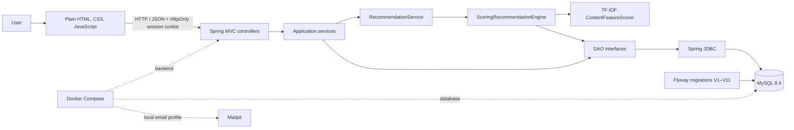

# RecomAI architecture

This diagram reflects the current repository structure. The browser uses same-origin HTTP and a server-side session cookie. Spring MVC controllers delegate validation and workflows to services. Services and the recommendation ranker use DAO interfaces backed by Spring JDBC. Flyway initializes or upgrades MySQL; Docker Compose runs the local application services.

## Repository boundaries

- `controller/` maps web requests and responses.
- `service/` coordinates validation and application behavior.
- `dao/` contains DAO contracts and parameterized JDBC queries.
- `recommendation/` contains the scoring engine and content-feature calculation.
- `model/` contains request, response, and domain records/classes.
- `web/` contains session access, request context, throttling, and response security headers.
- `backend/src/main/resources/db/migration/` is the append-only Flyway history; it stays beside Spring Boot's backend resources.
- `frontend/` contains the browser application served by Spring Boot from packaged `classpath:/static/` resources. Maven copies it into that classpath location at build time. It uses plain JavaScript modules, not a frontend framework.
- `database/` contains MySQL documentation and the schema reference. Runtime migration files remain in the backend resource tree.
- `e2e/` contains Playwright browser journeys. The E2E runner provisions its own uniquely named Compose project and disposable MySQL volume.

The diagram documents source/configuration structure. It is not evidence that external deployment or live-database tests have run in every environment.
