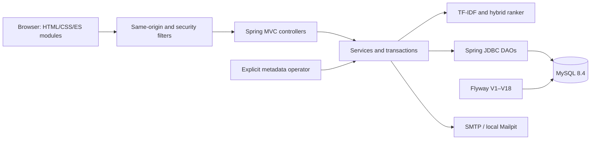

# Recom AI architecture

The browser runs HTML, CSS and JavaScript ES modules; Three.js draws the optional landing illustration. Maven copies `frontend/` into Spring Boot's `static/` resources. Spring MVC controllers validate transport input and use `SessionAccess`; services hold business rules and transactions; DAOs use Spring JDBC against MySQL 8.4. Flyway applies V1–V18. Mailpit captures local password-reset mail. No external LLM is involved.

[Frontend](../../frontend/) · [Java packages](../../backend/src/main/java/com/guvi/recommendationsystem/) · [all workflows](workflows.md) · [detailed architecture](../technical/Architecture.md)

Each deployment is one application instance with process-local sessions, rate limits and corpus caches. The ranker consumes bounded candidate signals; it does not query the web during recommendation requests.
