# Recom AI implementation workflows

## Frontend to backend

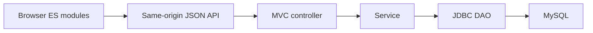

## Spring MVC request lifecycle

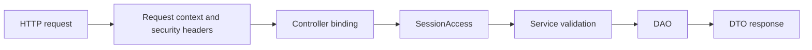

## Java package architecture

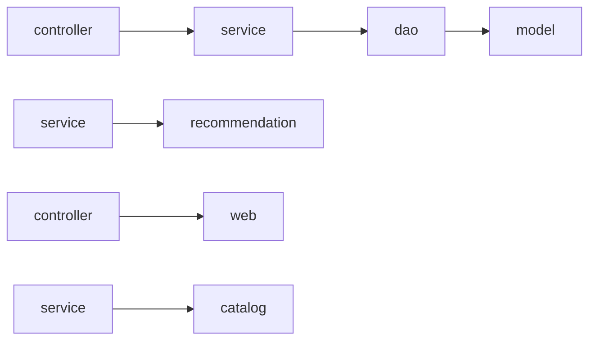

## Recommendation workflow

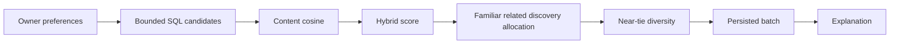

## TF-IDF and cosine

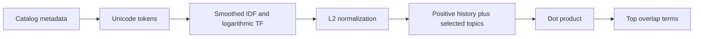

## Hybrid scoring

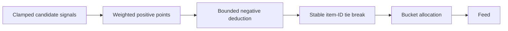

## User workflow

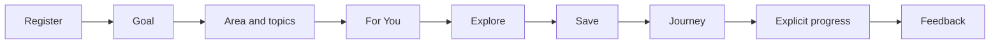

## Learning journey workflow

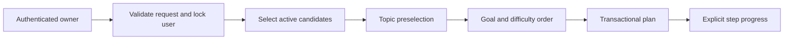

## Educational ingestion workflow

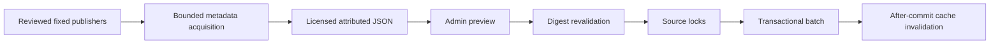

## Authentication and authorization

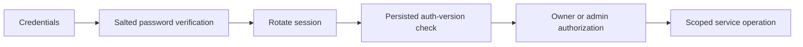

## Testing architecture

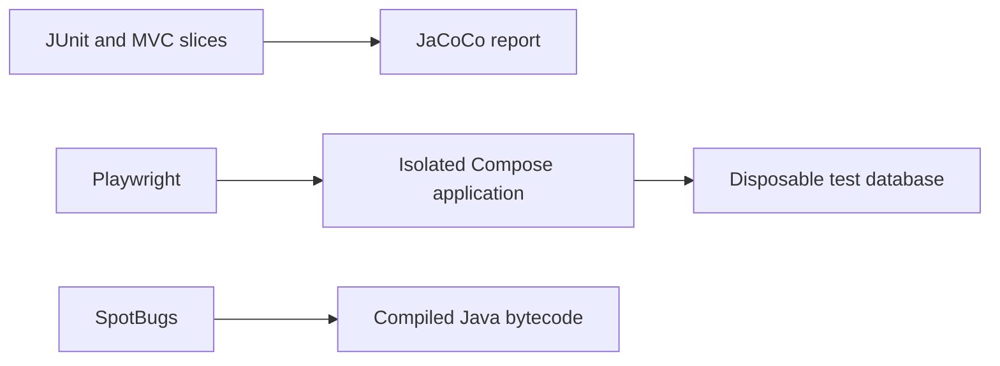
