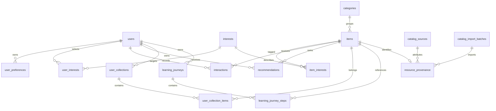

# Recom AI database

MySQL 8.4 stores 29 application tables plus Flyway history. [Schema-only reference](../technical/schema-only.sql) · [table details](../technical/Database-Reference.md) · [immutable migrations](../../backend/src/main/resources/db/migration/).

This overview shows core relationships, not every column. The schema reference supplies primary keys, foreign keys, uniqueness and indexes. Owner predicates protect private collections, activity and journeys. Source identities and canonical hashes prevent repeat imports; ambiguous editions go to review. Service transactions and locks serialize dependent writes. Never edit applied V1–V18, reset a valuable database or run `docker compose down -v` against it. New corrections require V19 or later.
